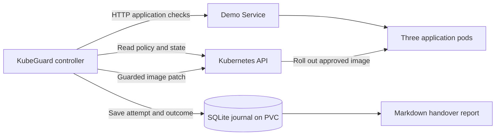

# KubeGuard

### Policy-controlled Kubernetes recovery with verified outcomes

KubeGuard helps demonstrate a practical answer to a common operational problem: **the pods are healthy, but the application is failing.** It detects failed application requests, restores an explicitly approved container image, verifies recovery, and saves an incident handover for engineers.

**Status: working MVP for local demonstrations and enterprise evaluation planning.** The recovery workflow has been demonstrated on a local kind cluster. Production deployment and enterprise integrations require further development.

## Business value

Platform and SRE teams repeatedly perform similar recovery actions after failed releases. KubeGuard explores how teams can define those actions in advance and execute them within explicit boundaries.

The intended benefits are:

- Faster restoration for rollback-compatible deployment failures.
- Less repetitive manual rollback work.
- Explicit control over which workload can change and which image can be restored.
- Recovery checks that confirm application behavior, beyond pod health.
- Persistent incident summaries for operational handover.

These are product objectives, not measured customer outcomes. The MVP does not yet send notifications or suppress pages.

## Capabilities available today

| Capability | Implementation |
| --- | --- |
| Failure detection | Synthetic HTTP checks approximately every five seconds; threshold of three consecutive failures |
| Explicit approval | Deployment annotations enable recovery and specify the approved image |
| Observation mode | Default mode logs `would_rollback` without changing the application |
| Controlled rollback | Restores the approved image on the demo Deployment |
| Concurrent-change protection | Atomic JSON Patch tests UID, resource version, and current image |
| Recovery verification | Complete rollout plus five consecutive successful application checks |
| Persistent records | SQLite incident journal mounted on a PersistentVolumeClaim |
| Handover report | Markdown output with UTC timestamps, status, incident identifier, and detail |
| Scoped API access | Read and patch permissions for only the named demo Deployment |
| Automated checks | Ten unit tests and a GitHub Actions workflow that runs tests and builds images |

The controller is currently restricted to `kubeguard-demo/demo`, with a single application container named `demo`. Recovery verification expects the sample application's `v1` response. This is not yet a general-purpose recovery controller for arbitrary workloads.

## Architecture



The controller uses Python's standard library and communicates with the Kubernetes API from inside the cluster. Prometheus, Grafana, and external databases are not required for this demo.

### Recovery workflow

1. A broken `v2` release returns HTTP 500 at `/`, while `/live` and `/ready` still return HTTP 200.
2. The controller observes three consecutive failed application requests.
3. It checks workload opt-in, the approved image, and whether the current image differs from that target.
4. In observation mode, it logs `would_rollback` and continues checking.
5. With execution enabled, it records `attempting` before changing the Deployment.
6. An atomic patch restores the image only if the checked Deployment state still matches.
7. For up to 120 seconds, it waits for the complete rollout and five consecutive successful requests reporting `v1`.
8. It records `recovered` or `needs_engineer`.

The journal retains the latest status for each Deployment UID/generation. It is an incident summary, not an append-only audit trail. Recorded attempts prevent repeat actions for the same UID/generation while the journal is retained.

## Repository structure

```text
kubeguard/
|-- app/
|   |-- main.py                 # Healthy and deliberately broken HTTP app
|   `-- Dockerfile              # Builds the v1 and v2 images
|-- controller/
|   |-- main.py                 # Detection, policy, rollback, and verification
|   |-- report.py               # Prints the incident handover
|   `-- Dockerfile              # Packages the controller
|-- k8s/
|   |-- namespace.yaml          # Project namespace
|   |-- demo.yaml               # Application Deployment and Service
|   |-- rbac.yaml               # Controller identity and API permissions
|   `-- controller.yaml         # Controller Deployment and journal volume
|-- tests/test_controller.py    # Recovery logic and safeguard tests
|-- docs/FILE_GUIDE.md          # Detailed file and function explanations
|-- .github/workflows/ci.yaml   # Unit tests and image builds
|-- .dockerignore
|-- .gitignore
`-- README.md
```

Read [the file guide](docs/FILE_GUIDE.md) for a detailed walkthrough.

## Run the demo

### Prerequisites

- Docker with its Linux engine running.
- `kind` and `kubectl` on your PATH.
- Python 3.12 or newer for local unit tests.
- Network access to pull the base images and kind node image.
- A default Kubernetes StorageClass to provision the journal volume.

Use Bash or Git Bash for the commands below. On Windows, Docker Desktop's WSL2 engine can run the containers while commands run in Git Bash.

### 1. Get the code and run tests

```bash
 git clone https://github.com/Sweata1403/KubeGuard.git
 cd KubeGuard
 python -m unittest discover -s tests -v
```

Use `python3` if that is your Python executable. If you already have the project, use its existing root folder instead of cloning again.

### 2. Create the cluster and build images

```bash
kind create cluster --name kubeguard --wait 120s
kubectl --context kind-kubeguard get nodes

docker build --build-arg APP_VERSION=v1 -t kubeguard-demo:v1 app
docker build --build-arg APP_VERSION=v2 -t kubeguard-demo:v2 app
docker build -t kubeguard-controller:v1 controller

kind load docker-image kubeguard-demo:v1 kubeguard-demo:v2 kubeguard-controller:v1 --name kubeguard
```

Reuse the cluster if it already exists. Images must be loaded into kind because its node has a separate image store.

### 3. Deploy

```bash
kubectl --context kind-kubeguard apply -f k8s/namespace.yaml
kubectl --context kind-kubeguard apply -f k8s/rbac.yaml
kubectl --context kind-kubeguard apply -f k8s/demo.yaml
kubectl --context kind-kubeguard apply -f k8s/controller.yaml

kubectl --context kind-kubeguard -n kubeguard-demo rollout status deployment/demo --timeout=120s
kubectl --context kind-kubeguard -n kubeguard-demo rollout status deployment/kubeguard --timeout=120s
kubectl --context kind-kubeguard -n kubeguard-demo get pods
```

The application runs three replicas. The controller runs one replica with `EXECUTE=false` by default.

### 4. Observe the bad release

```bash
kubectl --context kind-kubeguard -n kubeguard-demo set image deployment/demo demo=kubeguard-demo:v2
kubectl --context kind-kubeguard -n kubeguard-demo logs -f --tail=20 deployment/kubeguard
```

After three consecutive failures, expect `would_rollback` targeting `kubeguard-demo:v1`. Observation mode leaves the bad image running. Press Ctrl+C to stop following logs; the controller continues running.

### 5. Enable recovery

```bash
kubectl --context kind-kubeguard -n kubeguard-demo set env deployment/kubeguard EXECUTE=true
kubectl --context kind-kubeguard -n kubeguard-demo rollout status deployment/kubeguard --timeout=120s
kubectl --context kind-kubeguard -n kubeguard-demo logs -f --tail=20 deployment/kubeguard
```

Expected entries include:

```json
{"incident":"<uid>:<generation>","status":"attempting","detail":"Restoring approved image kubeguard-demo:v1"}
{"incident":"<uid>:<generation>","status":"recovered","detail":"Recovery verified"}
```

Restoring the image creates a new Deployment generation. Subsequent observation entries should show zero consecutive failures for that generation.

### 6. Inspect the result

Stop following logs with Ctrl+C, then run:

```bash
kubectl --context kind-kubeguard -n kubeguard-demo get deployment demo -o jsonpath='{.spec.template.spec.containers[0].image}'
kubectl --context kind-kubeguard -n kubeguard-demo exec deployment/kubeguard -- python report.py
```

The deployed image should be `kubeguard-demo:v1`. The report should contain a `recovered` incident with `Recovery verified`.

To view the recovered application:

```bash
kubectl --context kind-kubeguard -n kubeguard-demo port-forward service/demo 8080:8080
```

Open [localhost:8080](http://localhost:8080). Expected response:

```json
{"version":"v1","message":"orders available"}
```

Stop any earlier process using port 8080. Port-forwarding selects a pod; restart it if that pod is replaced during a rollout.

### 7. Disable execution and clean up

Return to observation mode:

```bash
kubectl --context kind-kubeguard -n kubeguard-demo set env deployment/kubeguard EXECUTE=false
```

When the disposable cluster is no longer needed:

```bash
kind delete cluster --name kubeguard
```

Deleting the cluster deletes its incident history. The PVC preserves records across controller pod replacements within the cluster; it is not a backup.

## Policy and safeguards

| Setting | Supplied value | Purpose |
| --- | --- | --- |
| Annotation `kubeguard.example/enabled` | `"true"` | Explicit workload opt-in |
| Annotation `kubeguard.example/approved-image` | `kubeguard-demo:v1` | Operator-approved rollback target |
| Controller environment `EXECUTE` | `false` | Enables changes only when set to `true` |
| Controller environment `JOURNAL` | `/data/incidents.db` | SQLite journal location |

Detection thresholds, polling intervals, service URL, and verification version are defined in code. Although the controller reads `NAMESPACE` and `DEPLOYMENT`, it rejects values other than the demo target.

Included safeguards:

- Namespaced Kubernetes permissions restricted to reading and patching the named Deployment.
- TLS validation and service account token re-reading for API requests.
- UID, resource version, and current-image checks before mutation.
- Persistent attempt recording before rollback.
- Non-root containers, read-only root filesystems, dropped Linux capabilities, and privilege escalation disabled.
- No Kubernetes service account token mounted into application pods.

### Operating boundaries

- Approval is operator-configured; KubeGuard does not automatically certify an image as healthy.
- Recovery changes only the container image. It does not restore environment variables, configuration, secrets, or database state.
- Run exactly one controller replica. Distributed coordination and leader election are not implemented.
- Interrupted actions remain `attempting` and require investigation; they are not automatically resumed.
- Failed verification becomes `needs_engineer`. This is a persisted status, not an actual pager notification.
- Failures while already on the approved image are observed without recovery action.
- A GitOps reconciler could reapply the bad image. Coordination with GitOps is not implemented.
- Synthetic requests are not a statistically meaningful traffic error-rate measurement.
- The sample HTTP server is a demonstration workload, not a production application server.

## Enterprise evaluation and roadmap

KubeGuard's proposed enterprise value is **controlled recovery for repeatable release failures, backed by evidence that the action restored service**.

A suitable evaluation starts with a stateless, rollback-compatible workload in an isolated environment. Define the recovery owner, approved target, success criteria, and manual fallback before adapting the demo-specific implementation. Begin in observation mode, then conduct controlled failure exercises.

Measure detection time, recovery time, successful recovery rate, false action rate, and engineer intervention against a manual baseline. No cost savings, availability improvement, or incident reduction percentage has been established yet.

| Area | Required development for broader adoption |
| --- | --- |
| Detection | Prometheus error-rate and latency windows, release correlation, false-positive controls |
| Recovery policy | General workload support, configurable runbooks, immutable image digests, rollback compatibility checks |
| Reliability | Leader election, interrupted-action reconciliation, configurable cooldowns, bounded retry policy |
| Integrations | GitOps and deployment pipeline coordination; actual escalation notifications |
| Governance | Approval workflows, append-only audit events, retention, and export |
| Security | Threat modeling, image scanning, dependency management, network policies, security review |
| Operations | Supported installation packaging, metrics, dashboards, backups, and upgrade procedures |
| Access | Authentication and SSO/RBAC for a future management interface; isolation where required |
| Commercial readiness | Defined license, support policy, service commitments, and legal review |

This repository currently provides no commercial license, SLA, compliance certification, management dashboard, SSO, or multi-cluster control plane. Establish these capabilities and commitments before representing the product as enterprise-ready.

## Validation

Ten unit tests cover opt-in and failure thresholds, avoiding rollback on the approved image, rollout completion, persistent attempt tracking, patch guards, replacement Deployment detection, and repeated successful recovery checks.

The local walkthrough demonstrated Docker builds, a three-replica Kubernetes application, observation-mode failure detection, automatic restoration to `v1`, recovery verification, and a saved incident report. This validates the demonstrated workflow, not production scale or reliability.

GitHub Actions runs the unit tests and container builds. A separate recovery job runs `python tests/e2e_recovery.py`: it creates a uniquely named kind cluster, verifies observation mode leaves the broken image unchanged, enables recovery, checks the exact incident's persisted result, confirms the restored image and HTTP response, and exports diagnostics before deleting its cluster. The initial recovery job passed in GitHub Actions. The expanded scenarios below require a new CI run.

Run the same test locally with Docker, kind, kubectl, and Python available:

```bash
python tests/e2e_recovery.py
```

The test uses a private kubeconfig and does not change your current Kubernetes context. Reports and diagnostics are written to `e2e-artifacts/`; GitHub Actions uploads these after the recovery job.

## Troubleshooting

| Symptom | Next step |
| --- | --- |
| Controller stays Pending | Check the journal PVC and default StorageClass using the commands below |
| `ImagePullBackOff` | Confirm the image tag and load it into the named kind cluster |
| Repeated `would_rollback` | Expected in observation mode; execution is disabled |
| `needs_engineer` | Read the incident detail and controller logs; no automatic retry occurs for that recorded generation |
| Persistent `attempting` | Investigate the actual workload and journal; interrupted-action reconciliation is not implemented |
| Port 8080 unavailable | Stop the previous server, container, or port-forward |

```bash
kubectl --context kind-kubeguard -n kubeguard-demo get pvc
kubectl --context kind-kubeguard get storageclass
kubectl --context kind-kubeguard -n kubeguard-demo describe pod <pod-name>
kubectl --context kind-kubeguard -n kubeguard-demo logs --tail=50 deployment/kubeguard
```

## Technical references

- [Kubernetes Deployments](https://kubernetes.io/docs/concepts/workloads/controllers/deployment/)
- [Kubernetes Services](https://kubernetes.io/docs/concepts/services-networking/service/)
- [Startup, readiness, and liveness probes](https://kubernetes.io/docs/tasks/configure-pod-container/configure-liveness-readiness-probes/)
- [Kubernetes RBAC](https://kubernetes.io/docs/reference/access-authn-authz/rbac/)
- [kind quick start](https://kind.sigs.k8s.io/docs/user/quick-start/)

For technical evaluation or improvement proposals, use this repository's Issues tab.

### Additional recovery boundary scenarios

The end-to-end test also enables execution while testing disabled workload opt-in and missing image approval. It waits for at least four failed observations, then checks that the image remains unchanged and no action was journaled. A separate scenario deliberately keeps APP_VERSION=v2 in the pod environment so restoring the v1 image cannot repair the application. The test requires needs_engineer, checks that the incident survives a controller restart, and confirms no further action occurs while already on the approved image. These scenarios use only the test's disposable cluster.

